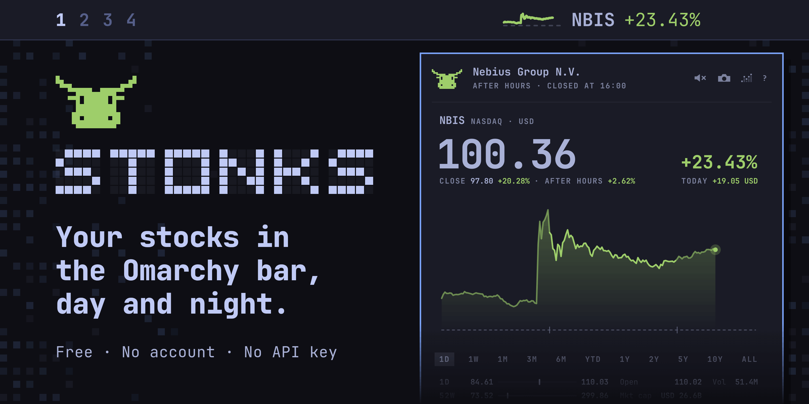
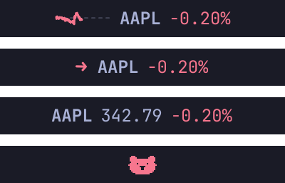
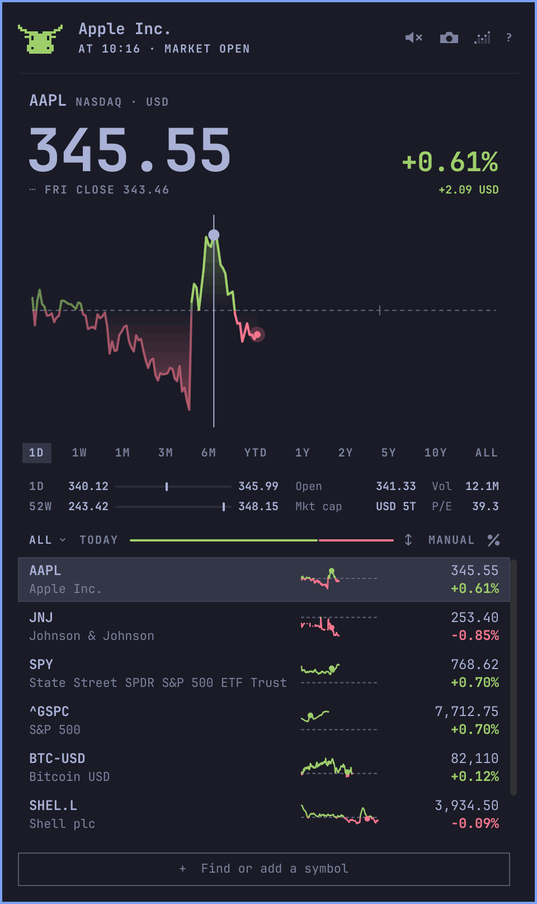
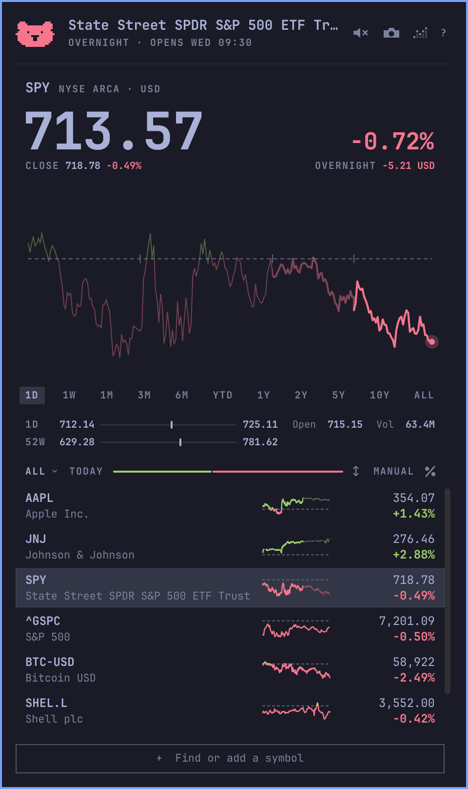
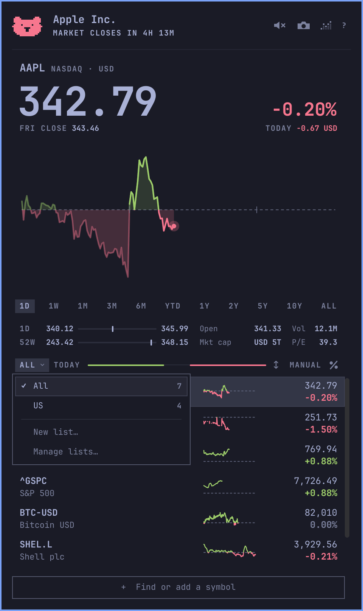
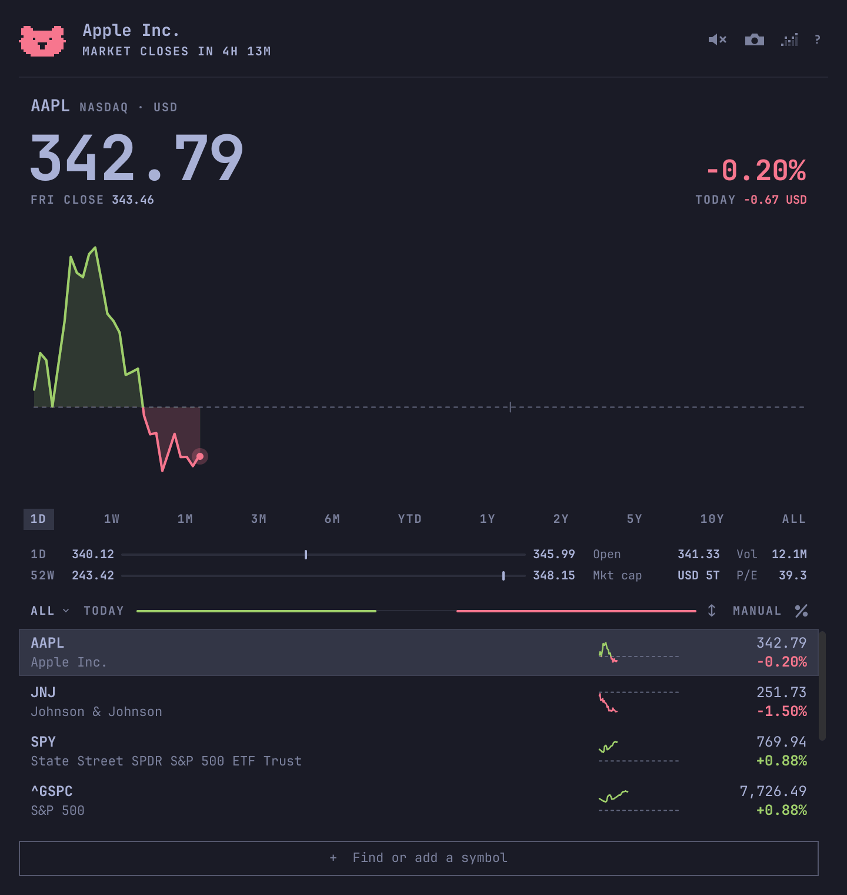
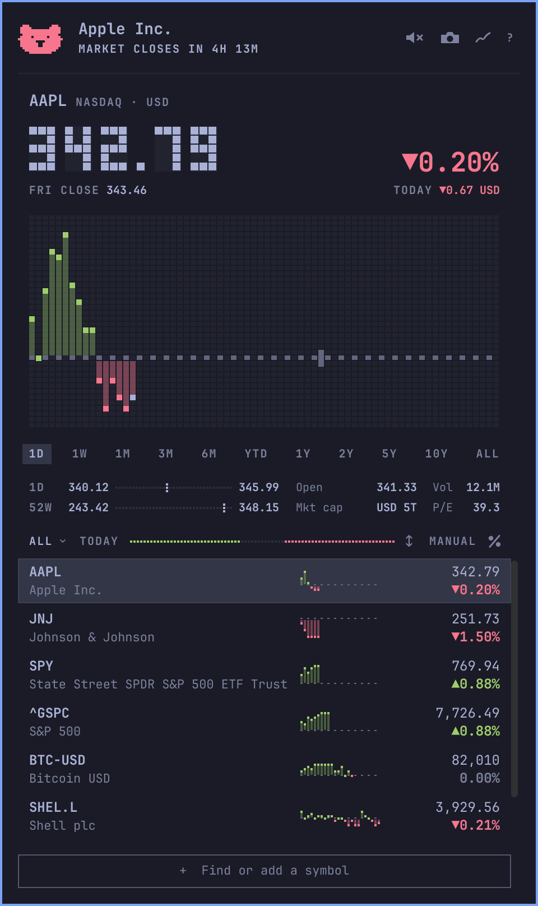
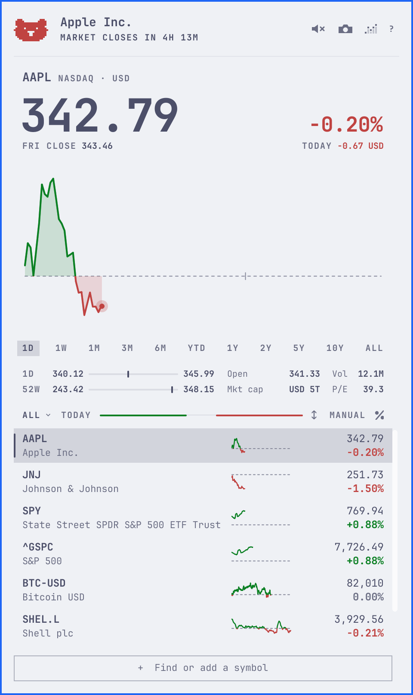

# Stonks

Stonks puts your stocks in the Omarchy bar, day and night. A small pill
shows how one stock is doing right now. Click it for the chart and your
lists.



```sh
omarchy plugin add https://github.com/gmchande/omarchy-stonks.git --enable
```

Made for Omarchy 4.5, and runs back to 4.0.6.

- Pre-market, after-hours and overnight prices for US stocks and ETFs, so
  a move at 02:00 shows at 02:00.
- Each price as Yahoo or Robinhood sent it, in the listing's own currency
  and on its exchange's clock. Stonks never converts a price, since a
  converted price is one nobody traded at.
- A price more than two minutes old while its market trades says "As of"
  and its time. A "!" on the pill means a refresh failed or is late.
- Each market's hours on its own clock, with the holidays and early closes
  of New York, Toronto, London and Tokyo.
- Stocks, ETFs, indexes and crypto, in lists of your own.
- Eleven ranges from one day to all time. Point anywhere on the chart for
  the price at that moment.
- A screenshot of any chart, sized so X shows it whole.
- Everything works by mouse alone, and `?` lists the keys.
- Light on your computer: with the panel closed, 152 stocks and one
  screen, Stonks uses about 0.1% of one core. It asks for a stock about
  once a minute while its market trades, less often while it's shut, and
  not at all while your screens are off.
- Free, with no account and no API key.

Stonks doesn't track your holdings, send price alerts or show news.

Website: [getstonks.app](https://getstonks.app) · On the marketplace:
[plugins.omarchy.org](https://plugins.omarchy.org/plugin.html?id=grvc.stonks)

## Install

The command at the top installs Stonks. Omarchy warns that plugins run
without a sandbox and asks you to confirm, then asks where in the bar to
put `grvc.stonks`, Stonks' id. The center is the default. To read the code
before it runs, leave out `--enable`, say no when Omarchy offers to enable
it, and run `omarchy plugin enable grvc.stonks` when you're ready.

On Omarchy 4 before 4.5, back to 4.0.6, Stonks runs without what 4.5
added: moving at the shell's own pace, keeping still when you turn
animations off, pressing in like the bar's icons, and saving screenshots
where Omasnap saves yours.

Stonks starts with NVDA, AAPL, MSFT, SPY and TSLA, so the pill has
something to show. Add your own and remove the ones you don't follow.

## The pill



The pill shows today's move for the stock you last looked at, as a
sparkline, an arrow, the price as text, or an icon: a bull on an up day, a
bear on a down one. Right-click it to switch. On a bar at the side of the
screen, it switches between the icon and the symbol over its change.

Click the pill for the panel, or middle-click it for the window. Scroll over
it to step through your list, and drag it to move it along the bar. Point
at it for what it has no room for: the icon's symbol and move, "After
hours" or "Pre-market" for a price from outside the session, and the time
of a late price.

At night, from the stock's first trade until the new day's first prices
arrive soon after 04:00, the pill keeps the day's close and move. Its line
draws tonight in grey, and pointing at it shows tonight's move.

## Reading the chart



Run the pointer along the chart to see where a stock was at any moment,
such as the morning's low. The price, the change and the rows follow it.
Click the bull or bear at the top left to replay the chart.

Pick a range under the chart, from 1D to ALL, and every stock shows that
range. The rows always show the day: click the %, ± or bell at the end of
the list's header to show their change as a percent, an amount, or the
percent since the open.

Under the ranges are the range's low and high, the open (or a longer
range's first price) and the volume, then the 52-week low and high, the
market cap and the P/E. The market cap is Yahoo's last reported figure,
moved with the price since. When a company reports earnings in another
currency, the P/E converts them at Yahoo's rate for the day, and nothing
else is converted. Yahoo's 52-week low and high leave out trades outside
the session, so when Stonks shows one beyond them, such as a trade
overnight, they widen to take it in.

The top line names the moment in the market's day, such as Power hour, and
says when the market opens or closes, on the exchange's clock. For a US
stock, the large price is its newest trade, after the close too. Elsewhere
it's the regular session's.

The move beside the price counts from the close that the chart's dashed
line marks, and the line under the price names that close, such as FRI
CLOSE 158.74. While the large price is still the close, that line shows the
pre-market or after-hours price instead. The line under the move names the
move and gives it in the other unit, such as TODAY ▲4.57 USD, OVERNIGHT
▼1.83 USD or PRE-MARKET ▼5.74 USD. A move in money always names its
currency, except an index's, which moves in points. On a longer range, the
move counts from the range's start. A coin never closes, so its day is its
last 24 hours.

On a US stock's first day, the move counts from its IPO price, as Yahoo
counts it, and the line under the price names it: IPO PRICE 83.00. Every
range counts from it that day, and says SINCE IPO. Until any new listing
first trades, its IPO price is the large price, with IPO PRICE under it, no
move, and an empty chart.

The 1D chart runs by the clock from the open to the close, or for a US
stock from 04:00, when its pre-market starts, to the end of after hours,
20:00 on most days. The line stops at the newest price and the hours still
to come stay empty, so the open sits in the same place every day, and a
jump before it shows where it happened. The regular session is bright and
the hours around it dim.



After the close, the chart keeps the day that closed until the next open,
and adds what trades in between at its end: tonight's trades, for a US
stock that trades at night, then any US stock's pre-market. The closed
day narrows to make room, and hours the market is shut take none, so a
weekend or a holiday adds nothing.

Those trades belong to the day ahead. From the first of them, the move
counts from the close just gone, and the dashed line marks that close. The
closed day draws fainter, since the move doesn't count it: a thinner line,
or in retro every other cell lit, still green above the dashed line and red
below. For about ten minutes after the open, until the new day has three
five-minute bars, the chart still keeps the day just closed, with the new
day's first trades at its end, so one or two trades don't fill the chart. A
US stock's bars count from 04:00, so one that traded before the open turns
right at it.

Stonks shows a US stock's night once Robinhood's prices hold a trade of it
from 20:00 to 04:00, tonight or the night before. For such a stock, once
tonight has traded, the chart brightens the session trading now, such as
tonight or the pre-market. The rows, like the pill, keep the day's close
and move until the pre-market's first prices arrive, soon after 04:00.
Their line draws tonight thinner and fainter in the same green and red, or
in retro as grey columns. Where Yahoo has no prices for half an hour or
more of the pre-market or after hours, the chart draws Robinhood's trades
there, never in place of Yahoo's.

A price says "As of" and its time when it's more than two minutes behind
while its market trades, or saved from before and not yet refreshed.

## Your lists



Click the list's name to switch lists, start one, or manage them. All
holds every symbol you follow, and your own lists each hold some of them.
To choose which lists a row is in, right-click it and pick "Choose
lists…", or Ctrl-click it. "New list…" there starts a list holding that
stock. In Manage lists, drag a list to move it, as you drag a row. All
stays first.

To find or add a stock, click "+ Find or add a symbol" or press `/`, and
type a name or a symbol. Stocks in the list you're looking at come first,
with today's move, then Yahoo's results. The chart shows the highlighted
result before you add it, and Enter or a click adds it. Right after you
start a list, search shows every stock in All first, and stays open after
each add, listing what you've added, until you click DONE or press Esc.

To remove a row, click the × beside its symbol, or select it and press
Delete. It leaves the list you're looking at, and removing it from All
removes it from every list, asking first if one of your lists holds it.
For 5 seconds, a button such as "Undo NVDA" brings it back. `Ctrl+Z` does
too, until you change a list again.

The line beside the list's name counts the rows up, in green, and down, in
red. Click the order at the right of the header, such as MANUAL, to sort by
symbol, name or change, and its arrow to reverse it. Sorting by change
ranks by percent, since amounts in different currencies can't be compared.
In your own order, drag a row to move it.

## The window



Stonks also opens as a tiled window with the panel's chart and rows.
Middle-click the pill, or run `omarchy-shell grvc.stonks toggleWindow`. To
float it, add a window rule for class `org.quickshell` and title `Stonks`.

To open the panel or the window with a key, add an `o.bind` line to
`~/.config/hypr/bindings.lua` with a key of your choice and one of these
commands:

```sh
omarchy-shell shell toggle grvc.stonks     # the panel
omarchy-shell grvc.stonks toggleWindow     # the window
```

To use the window without the pill, run `omarchy plugin disable
grvc.stonks`, then add `{ "id": "grvc.stonks" }` to `plugins` in
`~/.config/omarchy/shell.json` to keep Stonks loaded. To bring the pill
back, remove that entry and run `omarchy plugin enable grvc.stonks`.

To add Stonks to the app launcher:

```sh
cp ~/.config/omarchy/plugins/grvc.stonks/share/stonks.desktop ~/.local/share/applications/
mkdir -p ~/.local/share/icons/hicolor/scalable/apps
cp ~/.config/omarchy/plugins/grvc.stonks/share/grvc.stonks.svg ~/.local/share/icons/hicolor/scalable/apps/
```

## Smooth or retro



Stonks opens in smooth, with plain digits and a line chart. Retro draws
the price in block digits and the chart in pixel columns, the way Omarchy
draws its logo. Press `s`, or click the small chart icon at the top right,
to switch.



Both use your theme's green for up and its red for down, never its accent
color, which Omarchy keeps for what's selected. Where a theme's pair is
missing, too alike or too faint, Stonks uses its own. On a clear bar over
a light wallpaper, the pill's green and red darken with the bar's text.

## Sounds

Sounds are off until you click the speaker at the top right. Then adding,
removing or undoing a row makes a short sound, a screenshot clicks like a
shutter, a replay plays the line as it draws, and the chart chimes as you
run the pointer along it. A soft bell rings as the market of the stock you
last looked at opens and closes, unless Do Not Disturb is on or an app is
recording from your microphone. Refreshes and prices make no sound.

## Screenshots

Click the camera at the top right for a picture of the chart, sized so X
shows it whole. It shows the company's name, the price and its move, the
two lines under them, and the price's date, time and zone. Your list is
never in it. To take a moment on the chart, press `←` `→` to move to it,
then click the camera without crossing the chart, since the pointer leaving
the chart takes it back to now.

Like Omarchy's own screenshots, it goes to your screenshots folder and the
clipboard, with a notification that opens it in your screenshot editor.

## Keys

`?` lists these keys:

| Key | Does |
| --- | --- |
| `↑` `↓` | Move the selection |
| `⏎` | Show the selected row's chart |
| `a` or `/` | Find or add a symbol |
| Delete or Backspace | Remove the selected row |
| `Ctrl+Z` | Undo a removal |
| `r` | Refresh the prices |
| `←` `→` | Move along the chart |
| `[` `]` | Change the range |
| `s` | Switch between smooth and retro |
| `w` | Open the list menu |
| `o` | Change the order |
| `?` | Show these keys |

Omarchy's panel keys work too. `Esc` closes, and `Ctrl+↑` `Ctrl+↓` move
the selected row in your own order. In Manage lists, `Ctrl+↑` `Ctrl+↓`
move the selected list, `⏎` renames it, and Delete or Backspace asks to
delete it, which `⏎` confirms. In the panel, `j` `k` move the selection,
`h` `l` move along the chart, Space shows the selected row's chart, `x`
removes the selected row, and Tab or `Shift+Tab` switches to the bar's
next or previous panel.

## If something's wrong

A "!" on the pill means a refresh of its stock failed or is late. Point at
the pill to see which and, where Stonks knows, why and when it tries
again.

<details>
<summary>What each message means, and what to do</summary>

- **"Can't connect".** Yahoo sent nothing back. Rows keep the price they
  had, with its time. Check your internet: if other sites load, Yahoo may
  be down. Stonks retries within two minutes, and `r` retries at once.
- **"Server busy".** Yahoo asked Stonks to send fewer requests. Stonks
  retries at the time shown, at most 36 minutes on, and `r` won't hurry
  it.
- **"Not updating" or "No data" on a row, or "Can't get prices" on the top
  line.** A price hasn't come in time. Rows keep the price they had, with
  its time, and Stonks keeps trying, less often the longer Yahoo stays
  away. If Yahoo has changed what it sends, only a newer Stonks can fix
  it.
- **"Refresh failed" or "No data for this symbol" on a row.** Yahoo has
  nothing for the symbol, or sent a broken answer three times in a row.
  After a merger or a rename, search for the company to find what Yahoo
  calls it now. A delisted company may be gone for good. At night it can
  also mean Robinhood didn't answer, so a newer trade may be missing, and
  Stonks asks again within 5 minutes.
- **"As of" while the market is open.** Yahoo sends some prices late. When
  we measured, London, São Paulo and the VIX came 15 minutes late, and
  Mexico 20, while Nasdaq, NYSE, Toronto and crypto came within a minute.
  [Yahoo's table](https://help.yahoo.com/kb/SLN2310.html) lists the rest.
  An overnight price is Robinhood's last trade, which Stonks asks for
  every minute. It dims once that trade is more than two minutes old, as a
  thinly traded stock's often is at night. By day, a thinly traded stock
  says "As of" when it last traded more than two minutes ago.
- **A price looks wrong.** Check the currency, since Stonks never converts.
  PENCE means pence, as Yahoo quotes many London listings, so 3,580.00 is
  £35.80. For a US stock, the large price may be a trade after the close.
  Stonks leaves out prices of zero or less, and stray points in Yahoo's
  charts.
- **A dash for the move, with FIRST TRADES · MOVE SOON.** For a few
  minutes after a stock in London, Tokyo or Toronto first trades, Yahoo
  can still count its day from the close before last, so Stonks counts
  from the last close it saw itself. If it hasn't seen one, the move shows
  a dash until the stock has traded for ten minutes. Since the open, the
  move and the open stay blank until Yahoo sends the day's first
  five-minute bar, a few minutes into any market's day.
- **"No trades today", "No trades on" a day, or "Traded only at" a time.**
  The listing traded too little that day to draw a line.
- **"Not traded yet".** A new listing hasn't had its first trade. Its IPO
  price shows until it does.
- **"1W unavailable" or "Couldn't search", with RETRY.** Yahoo didn't send
  that chart or those results. Click RETRY, or in search reach it with `↓`
  and press `⏎`. After "Server busy", RETRY works once Yahoo lets Stonks
  back in, at most 36 minutes on.
- **"Couldn't search · try other words".** Yahoo can't search for what you
  typed, such as an emoji. Type other words.
- **"market hours unknown".** Stonks' calendar of holidays and early
  closes for this exchange has run out, so it can't say when the market
  opens. Prices and times are still right. [Update Stonks](#update) for a
  new calendar.
- **"Couldn't load your lists" in the footer.** Your lists file,
  `~/.config/omarchy/grvc.stonks.json`, can't be read or isn't valid JSON,
  often after a hand edit. Stonks won't write over it, so changes you make
  meanwhile are lost when it reads the file again or the shell restarts.
  Fix the file and save it, and Stonks reads it at once, or remove it to
  start over.
- **"Your changes aren't saved" in the footer.** Stonks can't write your
  lists file, and a restart loses every change since the last save. With
  "click to try again", the disk is full or the file or its folder is
  read-only: free some space or fix the permissions, then click the
  footer. With "fix or remove", Stonks can't read the file: fix it or
  remove it, as above.

To report a wrong price or anything else, use the
[bug form](https://github.com/gmchande/omarchy-stonks/issues/new?template=bug.yml).
For a price, give the symbol, the range and the time, what Stonks showed,
and what your broker or the exchange showed then.

</details>

## What it runs

Stonks isn't investment advice, and isn't affiliated with Yahoo or
Robinhood. Yahoo's endpoints are unofficial and Robinhood's data is for
personal use, so either may change or stop without notice. Robinhood's
prices fill the night, from 20:00 to 04:00 New York time, where Yahoo's
charts stop.

<details>
<summary>The commands it runs, the sites it asks, and the files it writes</summary>

**Commands**, all of which Omarchy ships:

- `curl` for every request, with a time limit and a size cap, and `stdbuf`
  with `head` to stop what it hands on at that cap.
- `sh`, `mkdir`, `chmod`, `mktemp`, `ln` and `rm`, to make its files and
  keep them readable only by you.
- `sh` with `dd`, to read your lists, the last prices, your theme's colours
  and the settings it reads from Omarchy and Omasnap: only an ordinary
  file, and only up to a size cap far above what a real one holds.
- `timeout`, to stop every command that should end if it hangs, and
  `setpriv`, so that if the shell stops a command outright, what the
  command started stops with it.
- When you paste into search or a list's name: `bash` with `wl-paste` and
  `head`, to read what you copied. A paste over 4 KB, or one that takes
  over 2 seconds, pastes nothing. When you select text there with the
  pointer, `wl-copy`, so a middle-click elsewhere pastes it.
- With sounds on: `pw-play` for each sound; `pw-cat` playing silence while
  you move along the chart, so each chime plays at once; as the bell is
  due, `bash` with `omarchy-shell notifications isDnd` and `pw-dump`, to
  check Do Not Disturb and that no app is recording; and `sh` with
  `md5sum` and `head`, once a run, to check its saved sounds.
- For a screenshot: `sh` with `sed`, `tail`, `date` and `head` to find
  your screenshots folder and name the file, `wl-copy` for the clipboard,
  and `omarchy-notification-send`. A click on the notification opens the
  picture in `omasnap`, or without it in `tensaku-edit` or the editor
  `OMARCHY_SCREENSHOT_EDITOR` names.
- Only when you ask for an update: `omarchy plugin update grvc.stonks` in
  a terminal, then `omarchy restart shell` when `git` shows the update
  moved Stonks' folder. After an update run elsewhere, `omarchy restart
  shell` alone, when you click the footer.

**Sites**, and nothing else:

- `query1.finance.yahoo.com` for prices, charts, the market cap and P/E,
  and the currency rate a P/E needs. It asks once for every row as the
  shell starts. Then, with only the pill on screen, it asks for the pill's
  stock alone: every minute while its market trades, every 5 minutes
  before and after the session, and every 15 minutes while it's closed.
  With the panel or the window open, it also asks for the rest of All, the
  rows in sight first: every minute while a row's market trades and every
  5 minutes before and after the session, but every minute for the stock
  on show, and never for a row whose market hasn't traded since its last
  price. With no pill in a bar, it asks nothing until you open the panel
  or the window. It also asks for a search result you pause on. To change
  "every minute", set `"refreshIntervalSec"` in
  `~/.config/omarchy/grvc.stonks.json` to a number of seconds from 30 to
  900.
- `query2.finance.yahoo.com` for search as you type, asking for each word
  once while search is open.
- `api.robinhood.com` for overnight prices, and for trades that fill a
  stretch Yahoo left empty. Once a day it asks the day each US stock
  listed, again 5 minutes later if that fails, and once for each stock the
  pill shows. Through the night it asks about the pill's stock and, with
  the panel or the window open, the stock on show and the rows in sight,
  with one past each edge: for the trades each one's chart draws every 5
  minutes, which say whether it trades at night, and for the last trade of
  each that does every minute, as often as `"refreshIntervalSec"` sets for
  Yahoo. It asks once more on a morning Yahoo has no prices for half an
  hour or more of the pre-market, and the same for a US stock or ETF you
  pause on in search.
- `raw.githubusercontent.com` for the newest version number, as the shell
  starts and once a day. To turn this off, add `"updateCheck": false` to
  `~/.config/omarchy/grvc.stonks.json`.

Stonks asks for nothing while every screen is off. When a site turns it
away, it waits about as long as the site asks, or longer each time, up to
36 minutes.

**Files:**

- `~/.config/omarchy/grvc.stonks.json`: your lists and settings.
- `~/.cache/grvc.stonks`, or `$XDG_CACHE_HOME/grvc.stonks` when that's
  set: the last prices, and the sounds Stonks makes for itself.
- Each screenshot, as `stonks-<symbol>-<date>_<time>.png` in the folder
  Omarchy's own screenshots use.

Only you can read the cache folder, and Stonks makes your lists file
readable only by you when it creates or saves it.
[`test/boundaries.sh`](test/boundaries.sh) fails if any code outside a few
allowed files runs a command, reads or writes a file, or makes a request.

</details>

## Update

```sh
omarchy plugin update grvc.stonks
omarchy restart shell
```

Or click the footer when it says "Update to …". A terminal opens, shows
what changes and asks. Say yes, and it updates Stonks and restarts the
shell. If Stonks has changes it hasn't saved, or can't read your lists
file, it updates without the restart, and the footer says "Updated to … ·
click to restart the shell", as it does after an update run anywhere else.
Stonks never updates itself.

From 1.2.1 or earlier, the terminal first stops at a page of the changes,
which `q` closes. Then say yes.

## Remove

```sh
omarchy plugin remove grvc.stonks
```

That removes the plugin and its pill, but leaves your lists, the saved
prices, and the launcher files if you added them. Delete what you don't
want:

```sh
rm ~/.config/omarchy/grvc.stonks.json   # your lists; keep it to reinstall later
rm -r "${XDG_CACHE_HOME:-$HOME/.cache}/grvc.stonks"
rm -f ~/.local/share/applications/stonks.desktop ~/.local/share/icons/hicolor/scalable/apps/grvc.stonks.svg
```

If you added them, also delete the `{ "id": "grvc.stonks" }` entry from
`plugins` in `~/.config/omarchy/shell.json`, and the `o.bind` lines from
`~/.config/hypr/bindings.lua`.

## Contributing

[CONTRIBUTING.md](CONTRIBUTING.md) says how to run your own copy, test it,
and send a change.

License: MIT, see [LICENSE](LICENSE). The sounds in `sounds/`, and the ones
Stonks makes as it runs, were made from code for Stonks. They're MIT too.

If Stonks earns a place in your bar, a heart on
[its marketplace page](https://plugins.omarchy.org/plugin.html?id=grvc.stonks)
helps the next person find it.
