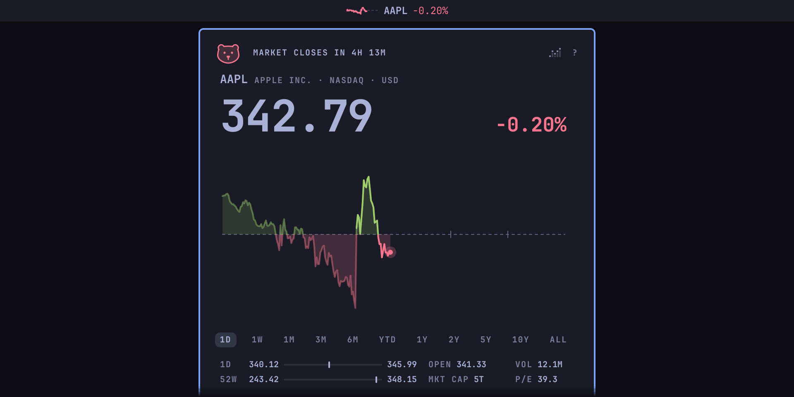
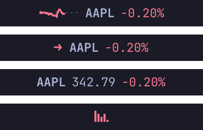
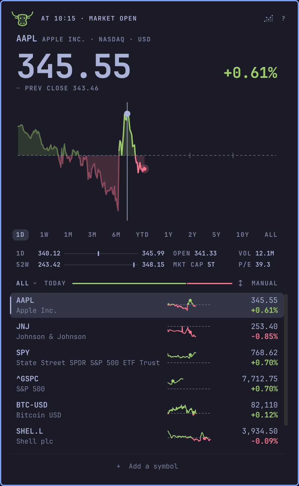
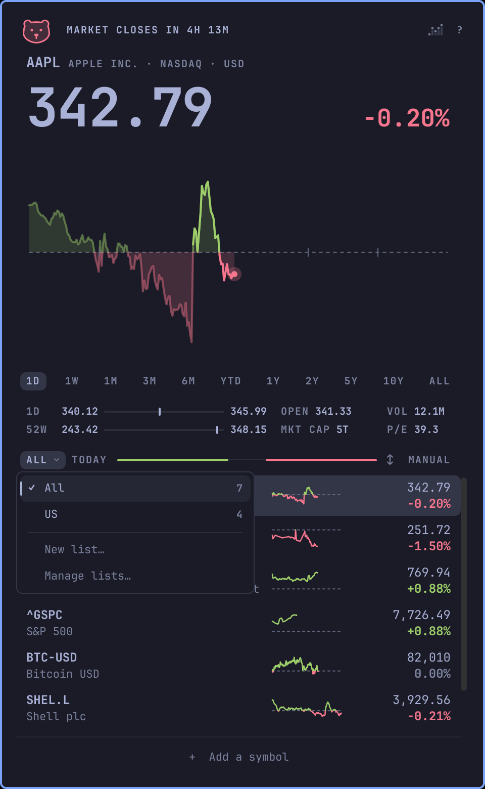
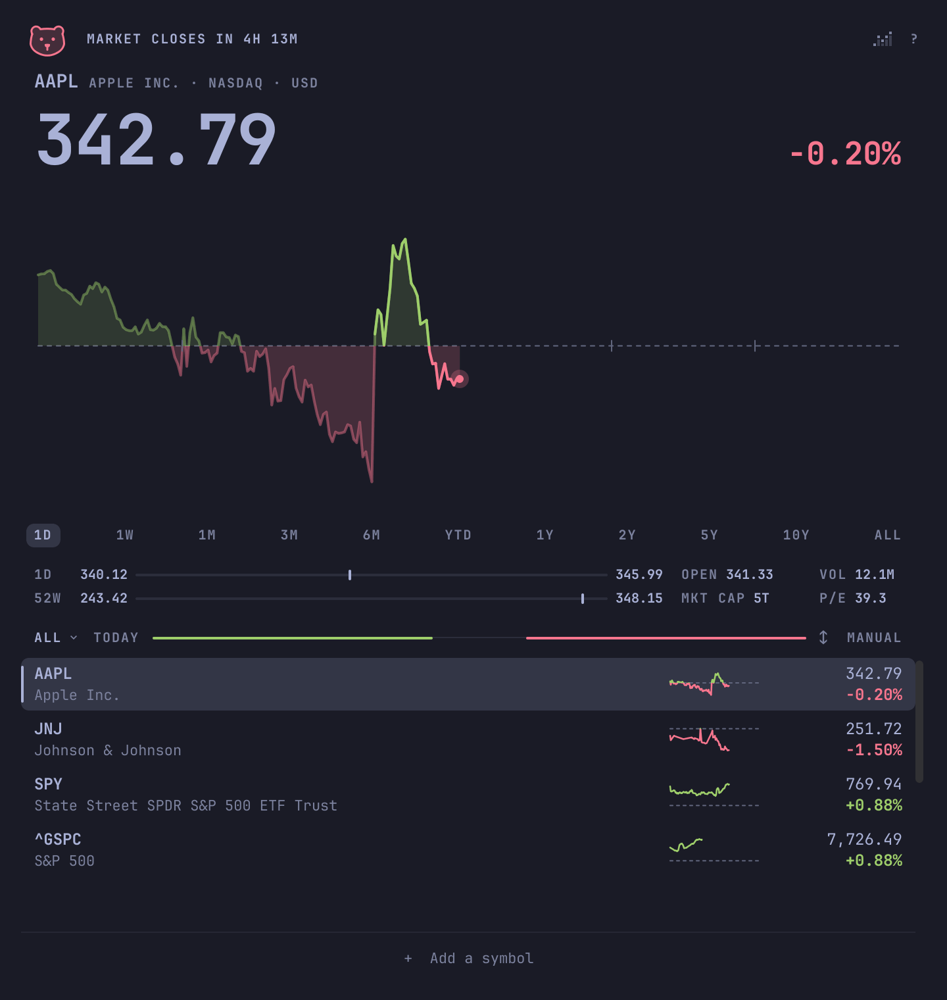
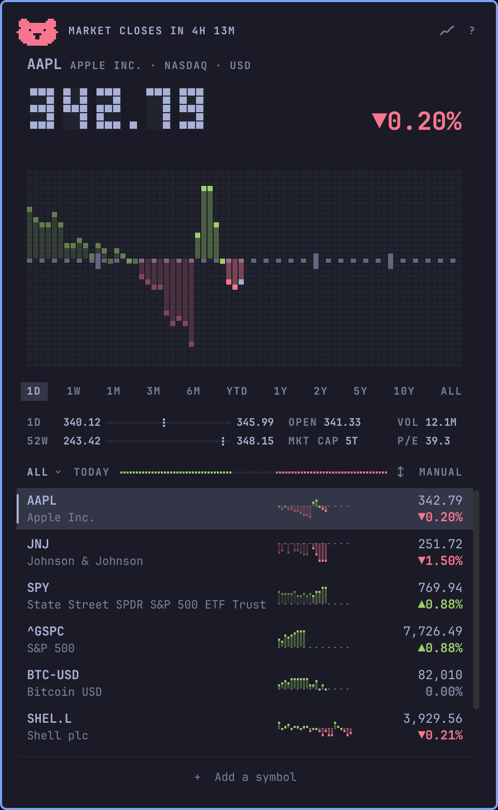

# Stonks

A stock watchlist plugin for the Omarchy 4 shell: today's move in your bar,
and a chart you can scrub a click away.



- Today's move in your bar; scroll over it to step through your stocks.
- Click for the day's chart and scrub it with the pointer, or pick a range
  from a week to all time.
- Pre-market, after-hours, and overnight prices, and when the market opens
  or closes.
- Stocks, ETFs, indexes, and crypto, from New York to London and Tokyo, each
  in its own currency.
- Lists of your own, such as a portfolio or a sector.
- Drawn in your theme's colours, with Stonks' own green and red where the
  theme's are missing, too alike, or too faint.
- No account and no API key.

It doesn't track holdings, send price alerts, or convert currencies.

## Install

Needs Omarchy 4.

```sh
omarchy plugin add https://github.com/gmchande/omarchy-stonks.git --enable
```

Omarchy warns that plugins run unsandboxed and asks you to confirm the
clone, then asks which bar section gets `grvc.stonks` (Stonks' id); the
centre is the default. To read the code first, leave out `--enable`, say no
when asked to enable it, and run `omarchy plugin enable grvc.stonks` when
you're ready.

## The pill



The pill shows today's move for the stock you last looked at, in one of four
forms: a sparkline, an arrow, the price as text, or Stonks' mark, a little
chart that climbs on an up day and falls on a down one. Middle-click it to
change its form.

Scroll over it to step through your list, left-click for the popup,
right-click for the window, and drag it to move it along the bar.

## Reading the day



Hover the chart to scrub back through the day: the price, the change, and
the rows follow the pointer. Click the bull, or on a down day the bear, to
replay the chart.

Pick a range under the chart, from 1D to All: every stock keeps it, even
after a restart, while the rows stay on today. On 1D, click the change
beside the price to see it as a percent, an amount, or since the open.

Under the ranges, two lines place the price between its low and high: for
the day or the range, and for the past 52 weeks. Beside them are the open
and volume, or a range's low and high dates, then the market cap and P/E.
The market cap is an estimate: Yahoo's last reported figure, moved with the
price since.

The top line says where the market is, in its own time: counting down to
the open or the close, after hours, or closed. A smaller line under the
price shows the pre-market, after-hours, or overnight price. The overnight
price is for the US stocks and ETFs Robinhood trades overnight.

An old price says "As of" and its time, on its row and above the price.
Old means more than two minutes behind while its market trades, or saved
from the last session. A refresh that fails, or gets no answer in 90
seconds, says so there and puts a "!" on the pill.

## Your lists



Click the list's name to switch lists, start one, or manage them. All holds
every symbol you follow, and your own lists hold some of them: Ctrl-click a
row to tick the lists it's in. Removing a symbol from All removes it
everywhere.

Click "+ Add a symbol" and type a name or a symbol: the top result shows in
the chart, and Enter or a click adds it. Search lists stocks, ETFs,
indexes, and crypto.

To remove a row, right-click it, or point at it and click the × beside its
symbol. A click on the note that then shows in the footer puts it back.

The line beside the list's name shows how many rows are up, in green, and
down, in red. Click the order word to sort by symbol, name, or change;
click its arrow to reverse the sort.

## The window



Stonks also opens in a tiled window: the popup's chart and rows at the
window's width. Right-click the pill, or run
`omarchy-shell grvc.stonks openWindow '{}'`, to open it. It shares the
popup's lists, range, and quotes. To float it, match
class `org.quickshell` and title `Stonks` in a window rule.

The window also works with no pill. Run
`omarchy plugin disable grvc.stonks`, then add `{ "id": "grvc.stonks" }` to
`plugins` in `~/.config/omarchy/shell.json` to keep the plugin loaded. To
bring the pill back, remove that entry first, then run
`omarchy plugin enable grvc.stonks center`.

For a key that opens and closes the window, add this line to
`~/.config/hypr/bindings.lua`:

```lua
o.bind("SUPER + SHIFT + T", "Stonks", "omarchy-shell grvc.stonks toggleWindow")
```

For Stonks in the app launcher, which `omarchy plugin add` doesn't set up:

```sh
cp ~/.config/omarchy/plugins/grvc.stonks/share/stonks.desktop ~/.local/share/applications/
mkdir -p ~/.local/share/icons/hicolor/scalable/apps
cp ~/.config/omarchy/plugins/grvc.stonks/share/grvc.stonks.svg ~/.local/share/icons/hicolor/scalable/apps/
```

## Smooth or retro



Retro draws the price in block digits and the charts in pixel columns, the
way Omarchy draws its logo. Click the small chart icon at the top right to
switch between smooth and retro.

## Keys

`?` opens a sheet of the everyday keys. Every key is in this table:

| Key | Does |
| --- | --- |
| `↑` `↓` | Move the selection |
| `j` `k` | Move the selection (popup) |
| `⏎` | Show the selected row's chart |
| Space | Show the selected row's chart (popup) |
| `←` `→` | Scrub one chart step |
| `h` `l` | Scrub one chart step (popup) |
| `[` `]` | Change the chart range |
| `p` | Replay the chart |
| `a` or `+` | Search and add a symbol |
| `x` | Remove the selected row |
| `u` | Undo the last removal, until a list next changes |
| Delete or Backspace | Remove the selected row (window) |
| `Shift+J` `Shift+K` | Move the selected row up or down, in manual order |
| `o` | Change the list's order |
| `Shift+O` | Reverse a sorted order |
| `w` | Open the list menu |
| `Shift+W` | Manage lists: rename, reorder, delete |
| `m` | Tick the selected row's lists |
| `,` `.` | Previous or next list |
| `c` | Show the day's change as a percent, an amount, or since the open |
| `s` | Switch between smooth and retro |
| `r` | Refresh |
| `1` to `9` | Show that row's chart |
| Tab or `Shift+Tab` | Next or previous panel on the bar (popup) |
| `?` | Open the key sheet |
| `Esc` | Close the sheet, then the scrub, then the popup or window |

## What it runs

- **Needs:** nothing beyond Omarchy 4. It runs `curl`, which Omarchy ships.
- **Commands:** `curl` for every request, and `omarchy restart shell` only
  when you click the update notice.
- **Hosts:** `query1.finance.yahoo.com` for quotes, charts, and the market
  cap and P/E; `query2.finance.yahoo.com` for search; and `api.robinhood.com`
  for overnight prices and which stocks trade overnight. Nothing else.
- **Data:** Yahoo's endpoints are unofficial, and its terms restrict
  automated access; Robinhood's data is for personal use. Either may change
  or stop without notice.
- **Files it writes:** your lists and settings in
  `~/.config/omarchy/grvc.stonks.json`, and the last quotes in
  `~/.cache/grvc.stonks/quotes.json`. The shell keeps the pill's form on its
  bar entry in `~/.config/omarchy/shell.json`.
- **Limits:** every request has a time limit and a size cap. Quotes come
  up to 20 listings to a request, so a long list refreshes in a few
  requests a minute. Each listing is asked for only as often as its market
  can move, and a host that refuses is left alone for a while.
- **Updates:** never by itself.

Every request runs through the one curl command in [`Fetch.js`](Fetch.js),
which sets its limits. [`test/boundaries.sh`](test/boundaries.sh) fails if a
command, a file read or write, or a request turns up outside the few files
allowed them. It runs on every push:

[](https://github.com/gmchande/omarchy-stonks/actions/workflows/checks.yml)

## Update

```sh
omarchy plugin update grvc.stonks
omarchy restart shell
```

Until the shell restarts, it runs the old version, and the popup says
"Updated to … · click to restart the shell".

## Remove

```sh
omarchy plugin remove grvc.stonks
```

That removes the plugin and its pill, and leaves the rest. Delete what you
no longer want:

```sh
rm ~/.config/omarchy/grvc.stonks.json   # your lists; keep it to reinstall later
rm -r ~/.cache/grvc.stonks
rm -f ~/.local/share/applications/stonks.desktop ~/.local/share/icons/hicolor/scalable/apps/grvc.stonks.svg
```

If you added them, also delete the `{ "id": "grvc.stonks" }` entry in
`plugins` in `~/.config/omarchy/shell.json`, and the `o.bind` line in
`~/.config/hypr/bindings.lua`.

## Contributing

How Stonks is built, how to run your checkout, the checks, and how to send a
change are in [CONTRIBUTING.md](CONTRIBUTING.md).

License: MIT, see [LICENSE](LICENSE).
