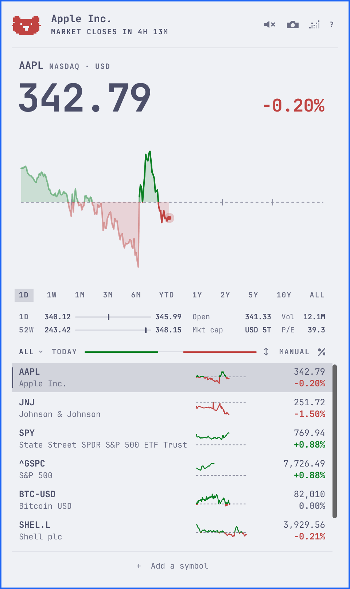

# Stonks

Stonks puts a stock watchlist in your Omarchy 4 bar. A small pill shows how
a stock is doing today. Click it for that stock's chart and your lists, and
move the pointer across the chart to see the price at any moment on it.


- Charts from one day to all time.
- Pre-market, after-hours, and overnight prices, and when the market opens
  or closes.
- Stocks, ETFs, indexes, and crypto, from New York to London and Tokyo, each
  in its own currency.
- Lists of your own, such as a portfolio or a sector.
- Two looks, smooth and retro, in your theme's colours, light or dark.
- No account and no API key.

It doesn't track holdings, send price alerts, or convert currencies.

## Install

Needs Omarchy 4.

```sh
omarchy plugin add https://github.com/gmchande/omarchy-stonks.git --enable
```

Omarchy warns that plugins run unsandboxed and asks you to confirm. Then it
asks where in the bar to put `grvc.stonks`, which is Stonks' id. The centre
is the default.

To read the code first, leave out `--enable`, say no when Omarchy offers to
enable it, and run `omarchy plugin enable grvc.stonks` when you're ready.

Stonks starts with five symbols so the pill has something to show: NVDA,
AAPL, MSFT, SPY, and TSLA. Add your own and remove any you don't follow.

## The pill


The pill shows today's move for the stock you last looked at, in one of four
forms: a sparkline, an arrow, the price as text, or the day's animal, the
bull on an up day and the bear on a down one. Middle-click it to change its
form. On a bar at the side of the screen it shows the animal, and a
middle-click there switches to the symbol over its change.

Scroll over it to step through your list, left-click for the popup,
right-click for the window, and drag it to move it along the bar.

## Reading the day


Hover the chart to scrub back through the day: the price, the change, and
the rows follow the pointer. Click the bull, or on a down day the bear, to
replay the chart.

Pick a range under the chart, from 1D to All. Every stock then shows that
range, even after a restart. The rows stay on the day's move. On 1D, click
the change beside the price to see it as a percent, an amount, or since the
open.

Under the ranges, two lines place the price between its low and high: for
the day or the range, and for the past 52 weeks. Beside them are the open
and volume, or a range's low and high dates, then the market cap and P/E.
The market cap is an estimate: Yahoo's last reported figure, moved with the
price since.

The top line says where the market is, in its own time: counting down to
the open or the close, after hours, or closed. A smaller line under the
price shows the pre-market, after-hours, or overnight price. The overnight
price is for the US stocks and ETFs Robinhood trades overnight.

An old price says "As of" and its time, on its row and above the price.
Old means more than two minutes behind while its market trades, or saved
from the last session. A refresh that fails, or gets no answer in 90
seconds, says so in the same places and puts a "!" on the pill.

## Your lists


Click the list's name to switch lists, start one, or manage them. All holds
every symbol you follow, and your own lists hold some of them. Ctrl-click a
row to choose the lists it's in. Removing a symbol from All removes it
everywhere.

Click "+ Add a symbol" and type a name or a symbol. The top result shows in
the chart, and Enter or a click adds it. Search finds stocks, ETFs,
indexes, and crypto.

To remove a row, right-click it, or point at it and click the × beside its
symbol. The footer then says what you removed, such as "Removed AAPL · click
to undo." Click it to bring the row back.

The line beside the list's name shows how many rows are up, in green, and
down, in red. Click the order word to sort by symbol, name, or change, and
click its arrow to reverse the sort.

## The window


Stonks also opens in a tiled window: the popup's chart and rows at the
window's width. To open it, right-click the pill or run
`omarchy-shell grvc.stonks openWindow '{}'`. It shares the popup's lists,
range, and quotes. To float it, match class `org.quickshell` and title
`Stonks` in a window rule.

The window also works with no pill. Run
`omarchy plugin disable grvc.stonks`, then add `{ "id": "grvc.stonks" }` to
`plugins` in `~/.config/omarchy/shell.json` to keep the plugin loaded. To
bring the pill back, remove that entry first, then run
`omarchy plugin enable grvc.stonks center`.

For keys that open and close the popup and the window, add these lines to
`~/.config/hypr/bindings.lua`. Omarchy doesn't use either key by default:

```lua
o.bind("SUPER + ALT + T", "Stonks popup", "omarchy-shell shell toggle grvc.stonks")
o.bind("SUPER + SHIFT + T", "Stonks window", "omarchy-shell grvc.stonks toggleWindow")
```

For Stonks in the app launcher, which `omarchy plugin add` doesn't set up:

```sh
cp ~/.config/omarchy/plugins/grvc.stonks/share/stonks.desktop ~/.local/share/applications/
mkdir -p ~/.local/share/icons/hicolor/scalable/apps
cp ~/.config/omarchy/plugins/grvc.stonks/share/grvc.stonks.svg ~/.local/share/icons/hicolor/scalable/apps/
```

## Smooth or retro


Retro draws the price in block digits and the charts in pixel columns, the
way Omarchy draws its logo. Click the small chart icon at the top right to
switch between smooth and retro.



Both looks draw in your theme's colours, light themes too: up in its green
and down in its red, or in Stonks' own pair where the theme's are missing,
too alike, or too faint.

## Sounds

Stonks makes a short sound when you add a symbol, remove a row, or undo the
removal, which plays the removal backwards. Run the pointer along the chart
and it plays like a row of chimes: each bar you cross rings its note, higher
where the line is higher, and each step of `←` `→` rings too. A replay plays
the chart's line as a tone, with a tick where it crosses the previous close.
Each look has its own voice. A soft bell rings as the market of the stock
you last looked at opens and as it closes, on time or not at all, and never
while every screen is off or an app records from your microphone. Nothing
else sounds by itself: no refresh or price. Click the speaker at the top
right, or press `Shift+S`, to turn sounds off; Stonks remembers. Your system
volume sets how loud they are.

## Keys

`?` opens a sheet of the everyday keys. Every key is in this table:

| Key | Does |
| --- | --- |
| `↑` `↓` | Move the selection |
| `j` `k` | Move the selection (popup) |
| `⏎` | Show the selected row's chart |
| Space | Show the selected row's chart (popup) |
| `←` `→` | Scrub one chart step |
| `h` `l` | Scrub one chart step (popup) |
| `[` `]` | Change the chart range |
| `p` | Replay the chart |
| `a` or `+` | Search and add a symbol |
| `x` | Remove the selected row |
| `u` | Undo the last removal, until a list next changes |
| Delete or Backspace | Remove the selected row (window) |
| `Shift+J` `Shift+K` | Move the selected row up or down, in manual order |
| `o` | Change the list's order |
| `Shift+O` | Reverse a sorted order |
| `w` | Open the list menu |
| `Shift+W` | Manage lists: rename, reorder, delete |
| `m` | Tick the selected row's lists |
| `,` `.` | Previous or next list |
| `c` | Show the day's change as a percent, an amount, or since the open |
| `s` | Switch between smooth and retro |
| `Shift+S` | Turn sounds off or on |
| `r` | Refresh |
| `1` to `9` | Show that row's chart |
| Tab or `Shift+Tab` | Next or previous panel on the bar (popup) |
| `?` | Open the key sheet |
| `Esc` | Close the sheet, then the scrub, then the popup or window |

## If something's wrong

A "!" on the pill means its stock's quote is late or its last refresh
failed: point at the pill to read which. The row and the line above the
price say the same.

- **A row says "No data" or "Update overdue".** Stonks has waited 90
  seconds on Yahoo: no answer came, or Yahoo turned it away. A row with a
  price keeps it, with the time it's from. Check your connection. If other
  sites load, Yahoo is down or refusing Stonks, and there's nothing to do
  but wait. Stonks keeps trying by itself, less often the longer Yahoo stays
  away, and `r` won't hurry it.
- **A row says "No data for this symbol" or "Refresh failed".** Yahoo said
  it has nothing for the symbol, or sent a broken answer three times
  running. A row with a price keeps it, with the time it's from, and `r`
  tries again. A symbol Yahoo has dropped, after a merger, a rename, or a
  delisting, stays this way: search for the company to find what Yahoo
  calls it now. If every row says it, the fault is Yahoo's. Stonks tries
  again at each refresh, but if Yahoo has changed what it sends, only a
  newer Stonks can fix that.
- **A stock or index says "As of" while its market is open.** Yahoo sends
  many exchanges' prices late, and some indexes'. When we measured,
  London's, São Paulo's, and the Cboe's VIX came 15 minutes late and
  Mexico's 20. Nasdaq's, NYSE's, Toronto's, and crypto came within a
  minute. For any other exchange, Tokyo's among them, see [Yahoo's table of delays](https://help.yahoo.com/kb/SLN2310.html).
  A thin stock can say it too, when its last trade was more than two
  minutes ago. The overnight price shows its own time, usually 10 to 15
  minutes back, since Robinhood reports those trades late, and dims once
  it's 20 minutes old.
- **A price looks wrong.** Each price is in its listing's currency, never
  converted, and shows no code where Yahoo names none, as for some
  indexes. A price marked GBp is in pence, as Yahoo quotes many London
  listings: 3,580.00 is £35.80. The large price is the regular session's.
  Pre-market, after-hours, and overnight trades show on the smaller line
  under it, which some apps show as the main price. The change is from the
  previous close, unless you've clicked it to show since the open. On a
  longer range, it's from the range's start. Stonks shows Yahoo's prices as
  sent, except for the odd stray price Yahoo drops into a chart, which it
  leaves out.
- **The day's chart says "No trades charted" or "Traded only at" a time.**
  The listing traded too little that day to draw a line.
- **The header says "1W unavailable", with RETRY beside it.** Yahoo didn't
  send that range's chart. Click RETRY, or press `r`. While Yahoo is
  turning Stonks away, a range fails at once.
- **Search says "Search didn't answer", with RETRY beside it.** Yahoo's
  search didn't answer. Click RETRY, or press Enter. While Yahoo is turning
  Stonks away, a search fails at once: try again in a moment.
- **The header says "schedule unavailable".** Stonks knows each exchange's
  holidays up to a set date. This exchange's have run out, so it can't say
  when the market next opens. Stonks doesn't update itself:
  [update it](#update) for a renewed calendar.
- **The footer says "Can't read grvc.stonks.json".** The file holding your
  lists can't be opened or isn't valid JSON, often after a hand edit.
  Stonks keeps the lists it has and writes nothing over the file until it
  can read it again. Fix the file and Stonks reads it as you save, or
  remove it to start over with the five starter symbols.

To report a price or chart that looks wrong, or anything this doesn't
answer, use the [bug form](https://github.com/gmchande/omarchy-stonks/issues/new?template=bug.yml).
For a price, give the symbol, the range, and the time (scrub the chart to
it), what Stonks showed, and what your broker or the exchange showed then.
The shell's log the form asks for can name the prices Stonks left out.

## What it runs

- **Needs:** nothing beyond Omarchy 4. It runs `curl` and PipeWire's
  `pw-play` and `pw-dump`, which Omarchy ships.
- **Commands:** `curl` for every request; while sounds are on, `pw-play` to
  play a sound, only when you add, remove, or undo a row, turn sounds on,
  replay a chart, or move along it, or the bell is due, and one `sh` that
  starts a `pw-play` for each chime and plays nothing else; `pw-dump` once
  as each bell is due, to see whether an app is recording from a
  microphone, reading only which streams run; `omarchy restart shell` only
  when you click the notice that an update is on disk; and, only when you
  click the note that a newer Stonks is out, `omarchy plugin update
  grvc.stonks` in a terminal.
- **Sites:** `query1.finance.yahoo.com` for quotes, charts, and the market
  cap and P/E; `query2.finance.yahoo.com` for search; `api.robinhood.com`
  for overnight prices and which stocks trade overnight; and
  `raw.githubusercontent.com` for the newest version number, as the shell
  starts and then once a day; when no answer comes, again 2 seconds later,
  doubling to about a minute. Nothing else.
- **Data:** Yahoo's endpoints are unofficial, and its terms restrict
  automated access; Robinhood's data is for personal use. Either may change
  or stop without notice. Some prices come late: [Yahoo's table](https://help.yahoo.com/kb/SLN2310.html)
  lists delays of up to 30 minutes for many exchanges and some indexes,
  London's and Tokyo's among them. Stonks isn't investment advice, and isn't
  affiliated with Yahoo or Robinhood.
- **Files it writes:** your lists and settings in
  `~/.config/omarchy/grvc.stonks.json`, the last quotes in
  `~/.cache/grvc.stonks/quotes.json`, and, while sounds are on, a replay's
  sound in `~/.cache/grvc.stonks/replay.wav`, written over at each replay,
  and the chimes' notes beside it, `chime-*.wav`, written each run.
  The shell keeps the pill's form on its bar entry in
  `~/.config/omarchy/shell.json`.
- **Limits:** every request has a time limit and a size cap. Quotes come
  up to 20 listings to a request, so a long list refreshes in a few
  requests a minute, and overnight prices up to 75. Stonks fetches each
  listing only as often as its market can move, and leaves a site that
  refuses it alone for a while. A window no screen shows, on another
  workspace or a screen switched off, fetches only what a closed one does.
- **Robinhood:** Stonks asks whether your US stocks and ETFs trade
  overnight, and for their overnight prices, both at once: for the stock on
  the pill once each time the shell starts, as its first price comes in; for
  the rest when the popup or window first opens, and for each one you add;
  and, while one is open, when you press `r` and every 5 minutes through a
  night that trades.
- **Updates:** never by itself. When a newer version is out, the footer
  says so for 5 seconds.

Every request runs through the one curl command in [`Fetch.js`](Fetch.js),
which sets its limits. [`test/boundaries.sh`](test/boundaries.sh) fails if a
command, a file read or write, or a request turns up outside the few files
allowed them. It runs on every push:

[](https://github.com/gmchande/omarchy-stonks/actions/workflows/fresh-clone.yml)

## Update

```sh
omarchy plugin update grvc.stonks
omarchy restart shell
```

Once a day, Stonks asks GitHub for the newest version. When it's newer than
yours, the footer says "Stonks … is out · click to update" for 5 seconds
as the popup or the window opens, once for each day's answer. A
click while it shows opens a terminal that runs `omarchy plugin update
grvc.stonks`, which shows what changes and asks before it updates. Until
the shell restarts, the old version keeps running, and the footer says
"Updated to … · click to restart the shell".

## Remove

```sh
omarchy plugin remove grvc.stonks
```

That removes the plugin and its pill. Your lists, the saved quotes, and the
launcher files, if you added them, stay. Delete what you no longer want:

```sh
rm ~/.config/omarchy/grvc.stonks.json   # your lists; keep it to reinstall later
rm -r ~/.cache/grvc.stonks
rm -f ~/.local/share/applications/stonks.desktop ~/.local/share/icons/hicolor/scalable/apps/grvc.stonks.svg
```

If you added them, also delete the `{ "id": "grvc.stonks" }` entry in
`plugins` in `~/.config/omarchy/shell.json`, and the `o.bind` lines in
`~/.config/hypr/bindings.lua`.

## Contributing

How Stonks is built, how to run your checkout, the checks, and how to send a
change are in [CONTRIBUTING.md](CONTRIBUTING.md).

License: MIT, see [LICENSE](LICENSE).
