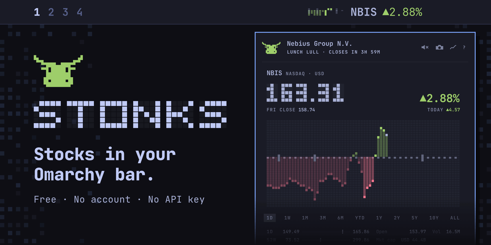
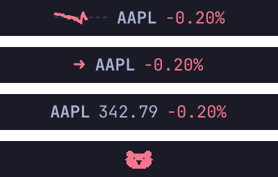
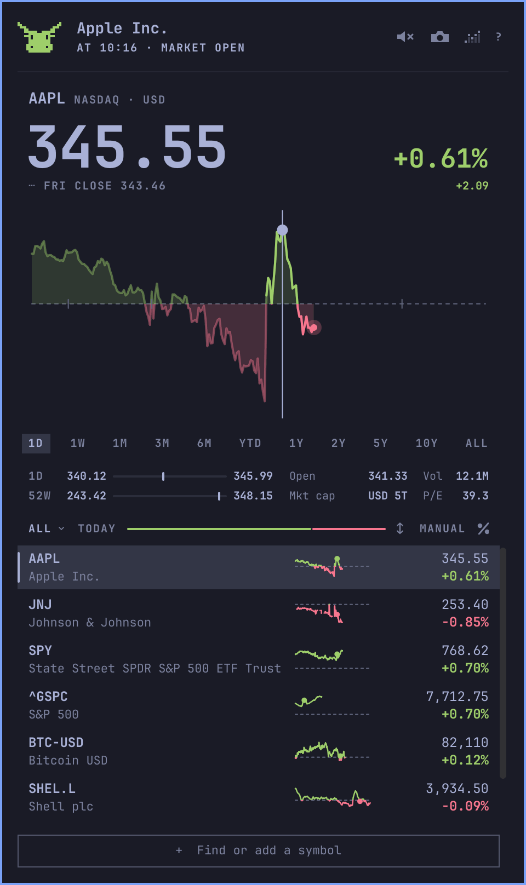
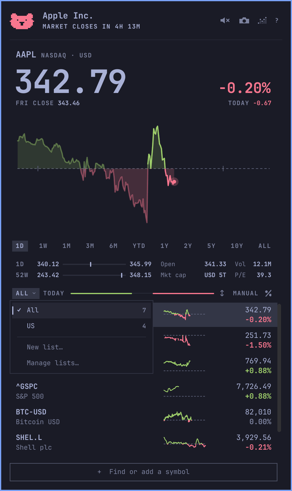
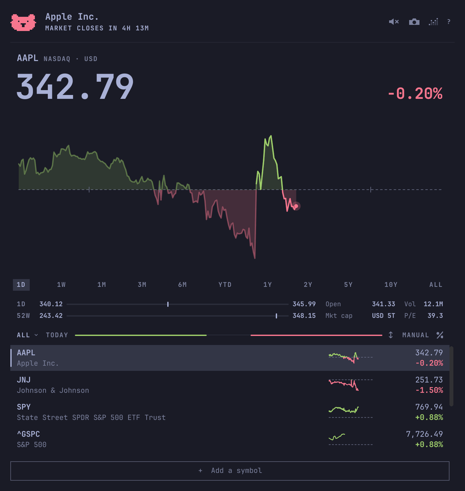
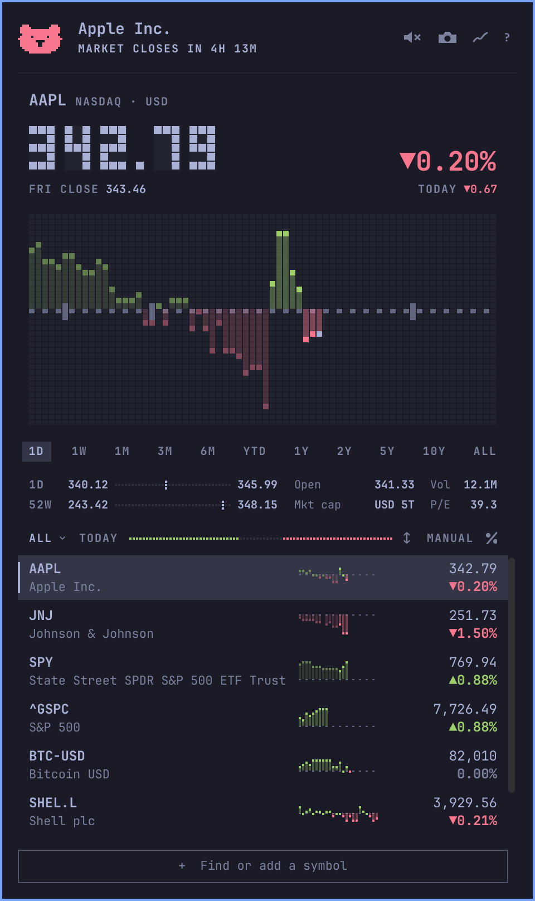
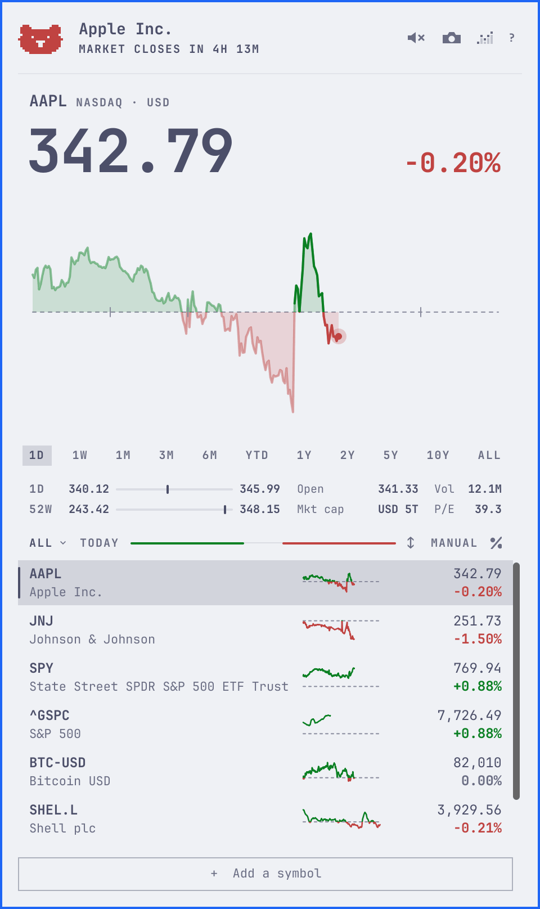

# Stonks

Stonks puts a stock ticker and your watchlist in the Omarchy bar, made for
Omarchy 4.5. A small pill shows how one stock is doing today. Click it for
the chart and your lists.



- Stocks, ETFs, indexes, and crypto from New York to London and Tokyo,
  with charts from one day to all time.
- Pre-market and after-hours prices, and overnight prices for the US
  stocks and ETFs that trade overnight.
- Point anywhere on the chart to see the price at that moment.
- Prices as Yahoo and Robinhood send them, in each listing's own currency
  and its exchange's own time. Prices aren't converted.
- Lists of your own, such as a portfolio or a sector.
- A screenshot of any chart, sized so X shows it whole.
- Everything works by mouse alone or by keyboard alone.
- Light on your computer: Stonks fetches nothing while your screens are
  off, and fetches each stock only as often as its market moves.
- Free, with no account and no API key.

Stonks doesn't track your holdings or send price alerts.

Website: [getstonks.app](https://getstonks.app)

[](https://plugins.omarchy.org/plugin.html?id=grvc.stonks)
[](https://plugins.omarchy.org/plugin.html?id=grvc.stonks)

## Install

Stonks is made for Omarchy 4.5: it moves at the shell's own pace, keeps
still when you turn animations off, presses in like the bar's own icons,
and saves screenshots where Omasnap saves yours. On earlier Omarchy 4
releases, back to 4.0.6, it runs without them.

```sh
omarchy plugin add https://github.com/gmchande/omarchy-stonks.git --enable
```

Omarchy warns that plugins run without a sandbox and asks you to confirm.
Then it asks where in the bar to put `grvc.stonks`, which is Stonks' id.
The center is the default. To read the code before it runs, leave out
`--enable` and say no when Omarchy offers to enable it. Run
`omarchy plugin enable grvc.stonks` when you're ready.

Stonks starts with five symbols so the pill has something to show: NVDA,
AAPL, MSFT, SPY, and TSLA. Add your own and remove the ones you don't
follow.

## The pill



The pill shows today's move for the stock you last looked at. It can show
a sparkline, an arrow, the price as text, or an icon: a bull on an up day,
a bear on a down one. Middle-click it to switch. It keeps your choice after
a restart. On a bar at the side of the screen, middle-click switches
between the icon and the symbol over its change.

Scroll over the pill to step through your list. Click it for the panel,
right-click it for the window, and drag it to move it along the bar.

## Reading the day



To see where a stock was at any moment, such as the morning's low, run the
pointer along the chart. The price and the change follow it, and so do the
rows, through the pre-market, the session and after hours. Click the bull
or bear at the top left to replay the chart.

Pick a range under the chart, from 1D to ALL. Every stock then shows that
range, even after a restart. The rows always show the day.

Rows show the day's change as a percent or an amount, or the percent change
since the open. To switch, click the %, ±, or bell at the end of the list's
header.

Under the ranges, the first line shows the range's low and high, with the
price between them. On 1D they take in the trades the chart draws outside
the session too: that day's night, pre-market and after hours. Beside
them are the open and the volume on 1D, or the range's starting price and
volume on a longer range. The second line shows
the 52-week low and high, with the market cap and P/E. On 1Y those are
the chart's own low and high. On every other range they're Yahoo's, which
leave out trades before and after the session, so when Stonks shows a
trade beyond them, such as one overnight, the low or high widens to it.
Stonks estimates
the market cap from Yahoo's last reported figure, moved with the price
since. When
a company reports earnings in another currency, Stonks converts them at
Yahoo's rate for the day, inside the P/E and nowhere else.

The top line names the moment in the market's day, such as Power hour, and
says when the market opens or closes, by the exchange's clock. A US stock
that has traded since the close shows that newest price on top, and its row
shows the time after the company's name. The move beside the price counts
from the close the chart's dashed line marks under that price, so the
number, the line, the bull or bear, the rows and the pill agree. Since the
open, it counts from that day's open instead.

The two lines under the price and the move each keep one job. Under the
price is the close before the price on top, named by its day: FRI CLOSE
158.74. Until the next session opens, it also shows how that day went:
CLOSE 153.27 ▼3.45%, or MON CLOSE once the day has passed. While the move
on top is a whole day's with trades after the bell in it, the part since the
close follows, · AFTER HOURS ▲1.35%, and it's the first thing to go when the
line runs out of room. Under the move is its name and the same move in the
other unit: TODAY ▲4.57, OVERNIGHT ▼1.83, PRE-MARKET ▼5.74, FRI ▼0.43 on a
day the market rests, or TODAY ▲2.88% when the figure on top is an amount.
Since the open it says SINCE OPEN, and on a longer range the range's name,
or SINCE and its first day for a listing younger than the range. A coin's
day is its last 24 hours: 24H AGO 80,711 and 24H ▼795.72. Where Stonks
doesn't know the close, as at Tokyo's open before Yahoo's first bar, both
lines stay empty, and where it has no calendar to name the close's day by,
the close is PREV CLOSE. Elsewhere, the line under the price shows the
pre-market or after-hours price.

The 1D chart shows one trading day, each price at its time, from the
day's first trade, or the open if that's earlier, to the day's end while
it runs, and to its last trade once it's over. The regular session is
bright and the hours around it dim.

For a US stock Robinhood trades at night, a day starts with its night, at
20:00 the evening before (New York time), and runs to 20:00. From the open
at 09:30 its start slides toward midnight, five minutes for every five that
pass, so by 13:30 the chart runs from 00:00 to 20:00 and gives the session
more room, whether the stock traded all morning or not. The trades it
slides past still count in the day's low and high.
Through the night, until 04:00, the chart keeps the day that just closed, so
it doesn't vanish at midnight while you're still reading it, and adds
tonight's trades at its right end: each five minutes added on the right
takes five off the left, so nothing jumps.
The session trading now is bright and the rest dim: the pre-market, the
regular session, after hours, or tonight. Until that session's first trade,
and while the market rests, the regular session stays bright.
Tonight's trades belong to the day ahead. From the night's first trade the
move counts from the close just gone, and the dashed line steps to that
close at the bell, with tonight's line green above it and red below.
Pointing at the chart reads against the dashed line under the pointer. The
move keeps counting from that close through the pre-market and the session,
until the next night starts, so nothing turns at 04:00. Since the open, the
move shows a dash until the day ahead opens. Soon after 04:00, once the new
day's first prices arrive, the chart turns to the new day, which starts with
the night just gone. A stock that didn't trade that night keeps its day
until its next trade. Once the day's date has passed, the list names the
day its rows measure, MON after midnight and FRI on Sunday night. Over a
weekend or a holiday the chart shows the last
trading day. On Sunday night and a holiday's evening, that day comes
first, then the night: the hours closed between them take no room, and
the line runs on from the day's last trade to the night's first. A day
that closes early, such as
the Friday after Thanksgiving, ends at 17:00 with no night after it.
If Yahoo sends no prices for half an hour or more of the pre-market or
after hours, and Robinhood shows trades in at least half of it, the chart
draws Robinhood's trades there. They never replace a price Yahoo sent.

A US stock that doesn't trade at night shows its day up to 20:00, and
keeps that day until its next trade. Once the chart shows a day
before today, the low, high, open and volume under it name it, such as
MON. When the list's US stocks and ETFs all measure a day that has ended,
such as Friday at the weekend, the list says so where it says TODAY. A coin
never closes, so its chart, its change, and its low and high cover the last
24 hours.

A price says "As of" and its time when it's old: more than two minutes
behind while its market trades, or saved from before and not yet
refreshed.

## Your lists



Click the list's name to switch lists, start a new one, or manage them. All
holds every symbol you follow, and your own lists each hold some of them.
To choose which lists a row is in, right-click it and pick "Choose lists…",
Ctrl-click it, or select it and press Ctrl+Enter.

To find a stock or add one, click "+ Find or add a symbol", or press `/`,
and type a name or a symbol. Stocks already in the list you're looking at
come first, with today's move, and Enter or a click shows one with its row
selected. Below them come Yahoo's results: the chart shows the highlighted
one before you add it, and Enter or a click adds it.

To remove a row, point at it and click the × beside its symbol, or select
it and press Delete. It leaves the list you're looking at. Removing it from
All removes it from every list, and asks first if one of your lists holds
it. Right-click a row to remove it from this list or from every list. For
5 seconds, a button such as "Undo NVDA" shows beside "+ Find or add a
symbol". `Ctrl+Z` also undoes it, until you change a list again.

The line beside the list's name shows how many rows are up, in green, and
down, in red. Point at it for the counts. Click the order at the right of
the header, such as MANUAL, to sort by symbol, name, or change, or to go
back to your own order. Click its arrow to reverse the sort. Sorting by
change ranks rows by percent, even while they show amounts, since amounts
in different currencies can't be compared. In your own order, drag a row
to move it.

## The window



Stonks also opens as a tiled window, with the panel's chart and rows at
the window's width. Right-click the pill, or run
`omarchy-shell grvc.stonks toggleWindow`. To float it, add a window rule
that matches class `org.quickshell` and title `Stonks`.

To open the panel and the window from the keyboard, add these lines to
`~/.config/hypr/bindings.lua`. Omarchy doesn't use either key by default:

```lua
o.bind("SUPER + ALT + T", "Stonks panel", "omarchy-shell shell toggle grvc.stonks")
o.bind("SUPER + SHIFT + T", "Stonks window", "omarchy-shell grvc.stonks toggleWindow")
```

To use the window without the pill, run `omarchy plugin disable grvc.stonks`,
then add `{ "id": "grvc.stonks" }` to `plugins` in
`~/.config/omarchy/shell.json` to keep Stonks loaded. To bring the pill
back, remove that entry, then run `omarchy plugin enable grvc.stonks`.

To add Stonks to the app launcher:

```sh
cp ~/.config/omarchy/plugins/grvc.stonks/share/stonks.desktop ~/.local/share/applications/
mkdir -p ~/.local/share/icons/hicolor/scalable/apps
cp ~/.config/omarchy/plugins/grvc.stonks/share/grvc.stonks.svg ~/.local/share/icons/hicolor/scalable/apps/
```

## Smooth or retro



Retro draws the price in block digits and the chart in pixel columns, the
way Omarchy draws its logo. Smooth uses plain digits and a line chart. To
switch, press `s`, or click the small chart icon at the top right.



Both use your theme's green for up and its red for down, on light themes
too, and never its accent color, which Omarchy keeps for what's selected.
Where a theme's pair is missing, too alike, or too faint, Stonks uses its
own.

## Sounds

Sounds are off until you turn them on. Press `m`, or click the speaker at
the top right. With sounds on, adding, removing, or undoing a row makes a
short sound, a screenshot clicks like a shutter, a replay plays the chart's
line as it draws, and the chart chimes as you run the pointer along it. A soft
bell rings as the market of the stock you last looked at opens and closes.
The bell keeps quiet while Omarchy's Do Not Disturb is on or an app is
recording from your microphone; the sounds of what you do still play.
Refreshes and prices make no sound.

## Screenshots

Press `Ctrl+C`, or click the camera at the top right, for a picture of the
chart, sized so X shows it whole. It shows the company's name, the price in
its currency, its move, and the same two lines the panel shows under them,
with the date, time and zone of the price at its foot. If you've moved along
the chart with `←` `→`, it shows that moment. With the pointer, press
`Ctrl+C` while it's still on the chart: moving it off to the camera ends the
scrub. Your list is never in it.

Stonks treats it like Omarchy's own screenshots. It saves the picture to
your screenshots folder, copies it to the clipboard, and shows a
notification. Click the notification to open the picture in your
screenshot editor.

## Keys

`?` lists the keys you'll use every day. This table has them all:

| Key | Does |
| --- | --- |
| `↑` `↓` | Move the selection |
| `⏎` | Show the selected row's chart |
| `Ctrl+⏎` | Choose the selected row's lists |
| `←` `→` | Move along the chart |
| `[` `]` | Change the range |
| `p` | Replay the chart |
| `Ctrl+C` | Take a screenshot |
| `a` or `/` | Find or add a symbol |
| Delete or Backspace | Remove the selected row |
| `Ctrl+Z` | Undo a removal |
| `Ctrl+↑` `Ctrl+↓` | Move the selected row, in your own order |
| `o` | Change the order |
| `Shift+O` | Reverse the order |
| `w` | Open the list menu |
| `c` | Show the change in %, an amount or since the open |
| `s` | Switch between smooth and retro |
| `m` | Turn sounds on or off |
| `r` | Refresh |
| `Shift+U` | Update Stonks when a new version is out, and restart the shell to run it |
| Tab or `Shift+Tab` | Switch to the bar's next or previous panel (panel only) |
| `?` | Show the keys you'll use every day |
| `Esc` | Close |

## If something's wrong

A "!" on the pill means a refresh of its stock failed or is late. Point at
the pill to see which, and, where Stonks knows, why and when it tries
again.

<details>
<summary>What each message means, and what to do</summary>

- **"Can't connect".** Stonks asked Yahoo for prices and nothing came
  back. Rows keep any price they had, with its time. Check your internet.
  If other sites load, Yahoo may be down or out of reach. Stonks retries
  within two minutes, and `r` retries at once.
- **"Server busy".** Yahoo asked Stonks to send fewer requests. Stonks
  retries at the time shown, at most 36 minutes on, and `r` won't
  hurry it.
- **"Not updating" or "No data" on a row, or "Can't get prices" on the top
  line.** A price hasn't come in time. When that's true of every stock you
  follow, the top line says so once instead of on every row. Rows keep
  any price they had, with its time. Stonks keeps trying on its own, less
  often the longer Yahoo stays away. If Yahoo has changed what it sends,
  only a newer Stonks can fix it.
- **"Refresh failed", or "No data for this symbol" on a row.** Yahoo has
  nothing for the symbol, or sent a broken answer three times in a row.
  Stonks keeps retrying on its own. After a merger or a rename, search for
  the company to find what Yahoo calls it now. A delisted company may be
  gone for good.
- **"As of" while the market is open.** Yahoo sends some prices late. When
  we measured, London, São Paulo, and the VIX came 15 minutes late, and
  Mexico 20. Nasdaq, NYSE, Toronto, and crypto came within a minute.
  [Yahoo's table](https://help.yahoo.com/kb/SLN2310.html) lists the rest.
  A thinly traded stock says "As of" when its last trade was more than two
  minutes ago. Overnight prices usually run 10 to 15 minutes behind, since
  Robinhood reports those trades late.
- **A price looks wrong.** Check the currency: Stonks never converts,
  since a converted price is one nobody traded at. PENCE means pence, as Yahoo quotes many London listings, so 3,580.00 is
  £35.80. A US stock's large price is its newest trade, after the close
  too, with the close on the line under it. Elsewhere the large price is
  the regular session's, and the smaller line shows trades outside it.
  The change counts from the close the chart's dashed line marks under the
  price, which at night is the close just gone, unless you've switched it
  to since the open. On a longer range, it's from the range's start. Stonks
  leaves out prices of zero or less, and stray points in Yahoo's charts.
- **A dash for the move just after an open.** For a few minutes after a
  stock in London, Tokyo or Toronto first trades, Yahoo can still count
  its day from the close before last. Stonks counts from the last close it
  saw itself. If it started in those minutes and hasn't seen that close, it
  shows a dash for the move until the stock has traded for ten minutes,
  then fills it in. With the rows set to since the open, the move shows a
  dash too, and the open under the chart stays blank, until Yahoo sends the
  day's first five-minute bar. That can take a few minutes at any market's
  open.
- **"No trades today", "No trades on" a day, or "Traded only at" a time.**
  The listing traded too little that day to draw a line.
- **"1W unavailable" or "Couldn't search", with RETRY.** Yahoo didn't
  send that chart or those results. Click RETRY. While search says
  "server busy", RETRY works again once Yahoo lets Stonks back in, at most
  36 minutes on.
- **"Couldn't search · try other words".** Yahoo can't search for what you
  typed, such as an emoji. Type other words.
- **"market hours unknown".** Stonks carries the holidays and early
  closes of New York, Toronto, London and Tokyo, and this exchange's
  calendar has run out. An early Stonks
  worked out the next open for itself and got Labor Day wrong, so now it
  says when it doesn't know. Prices and times are still right.
  [Update Stonks](#update) for a new calendar.
- **"Couldn't load your lists" in the footer.** Your lists file,
  `~/.config/omarchy/grvc.stonks.json`, can't be read or isn't valid JSON,
  often after a hand edit. Stonks won't write over it. Changes you make
  meanwhile are lost when Stonks reads the file again or the shell
  restarts. Fix the file and save it, and Stonks reads it at once. Or
  remove it to start over.
- **"Your changes aren't saved" in the footer.** Stonks can't write your
  lists file. Beside "click to try again", the disk is full or the file or
  its folder is read-only: free some space or fix the permissions, then
  click the footer. Beside "fix or remove", Stonks can't read the file and
  won't write over it: fix it or remove it, as above. Either way, a
  restart loses every change since the last save.

To report a wrong price or anything else, use the
[bug form](https://github.com/gmchande/omarchy-stonks/issues/new?template=bug.yml).
For a price, give the symbol, the range, and the time, what Stonks showed,
and what your broker or the exchange showed then.

</details>

## What it runs

Stonks isn't investment advice, and isn't affiliated with Yahoo or
Robinhood. Yahoo's endpoints are unofficial, and Robinhood's data is for
personal use, so either may change or stop without notice. Stonks uses
them because when we looked, in September 2026, no other free source
without a key had live prices, the day's chart and years of history
together. Robinhood's prices fill the night, from 20:00 to 04:00 New York
time, when Yahoo's charts are empty.

<details>
<summary>The commands it runs, the sites it asks, and the files it writes</summary>

**Commands**, all of which Omarchy ships:

- `curl` for every request, with a time limit and a size cap.
- `sh`, `mkdir`, `chmod`, `mktemp`, `ln`, and `rm`, to make its files and
  keep them readable only by you.
- `timeout`, to stop its file, sound, and screenshot commands if they
  hang.
- With sounds on: `pw-play` for each sound; `pw-cat` playing silence while
  you move along the chart, so each chime plays at once; as the bell is
  due, `bash` with `omarchy-shell notifications isDnd` to check Do Not
  Disturb, and `pw-dump` to check that no app is recording; and `sh` with
  `md5sum` and `head`, once a run, to check its saved sounds.
- For a screenshot: `sh` with `sed`, `tail`, `date`, and `head` to find
  your screenshots folder and name the file, `wl-copy` for the clipboard,
  and `omarchy-notification-send`. A click on the notification opens the
  picture in `omasnap`, or without it in `tensaku-edit` or the editor
  `OMARCHY_SCREENSHOT_EDITOR` names.
- Only when you ask for an update: `omarchy plugin update grvc.stonks` in
  a terminal, then `omarchy restart shell` when `git` shows the update
  moved Stonks' folder. After an update run elsewhere, `omarchy restart
  shell` alone, when you click the footer or press `Shift+U`.

**Sites**, and nothing else:

- `query1.finance.yahoo.com` for prices, charts, the market cap and P/E,
  and the currency rate a P/E needs. With only the pill on screen, Stonks
  asks for the pill's stock alone: every minute while its market trades,
  every 5 minutes before and after the session, and every 15 minutes while
  it's closed. As the shell starts, it asks once for every row. When you
  open the panel or the window, it asks for the stock at the top, then the
  rows you can see, then the rest of All, and keeps them fresh while it's
  open: every minute while a row's market trades, and every 5 minutes
  before and after the session (every minute for the stock on show). It
  leaves out a row whose market hasn't traded since its last price. When
  you pause on a search result you haven't added, it asks for that stock
  too, while it's on screen.
- `query2.finance.yahoo.com` for search, as you type. Words it has looked
  up since you opened search aren't asked again.
- `api.robinhood.com` for overnight prices, and for the trades that fill a
  stretch Yahoo left empty: once a day for which stocks trade overnight, at
  most once for each stock the pill shows, and every 5 minutes through the
  night for the pill's stock, and for every row that trades overnight while
  the panel or the window is open; and once more on a morning Yahoo sends no
  prices for half an hour or more of the pre-market. It asks the same for
  a US stock or ETF you pause on in search and haven't added.
- `raw.githubusercontent.com` for the newest version number, as the shell
  starts and once a day. To turn this off, add `"updateCheck": false` to
  `~/.config/omarchy/grvc.stonks.json`.

Stonks asks for nothing while every screen is off. When a site turns it
away, it waits before asking again: about as long as the site asks, or
longer each time, up to 36 minutes.

**Files:**

- `~/.config/omarchy/grvc.stonks.json`: your lists and settings.
- `~/.cache/grvc.stonks`, or `$XDG_CACHE_HOME/grvc.stonks` when that's
  set: the last prices, and the sounds Stonks makes for itself.
- Each screenshot, as `stonks-<symbol>-<date>_<time>.png` in the folder
  Omarchy's own screenshots use.

Only you can read the cache folder. Stonks makes your lists file readable
only by you when it creates or saves it.
[`test/boundaries.sh`](test/boundaries.sh) fails if any code outside a
few allowed files runs a command, reads or writes a file, or makes a
request.

</details>

## Update

```sh
omarchy plugin update grvc.stonks
omarchy restart shell
```

Or, when the footer says "Update to …", click it or press `Shift+U`. A
terminal opens and shows what changes. Say yes, and it updates Stonks and
restarts the shell, unless Stonks has changes it hasn't saved or can't read
your lists file. Then, or after an update run anywhere else, the footer says
"Updated to … · click to restart the shell". Stonks never updates itself.

## Remove

```sh
omarchy plugin remove grvc.stonks
```

That removes the plugin and its pill, but leaves your lists, the saved
prices, and the launcher files if you added them. Delete what you don't
want:

```sh
rm ~/.config/omarchy/grvc.stonks.json   # your lists; keep it to reinstall later
rm -r "${XDG_CACHE_HOME:-$HOME/.cache}/grvc.stonks"
rm -f ~/.local/share/applications/stonks.desktop ~/.local/share/icons/hicolor/scalable/apps/grvc.stonks.svg
```

If you added them, also delete the `{ "id": "grvc.stonks" }` entry from
`plugins` in `~/.config/omarchy/shell.json`, and the `o.bind` lines from
`~/.config/hypr/bindings.lua`.

## Contributing

[CONTRIBUTING.md](CONTRIBUTING.md) says how to run your own copy, test it,
and send a change.

License: MIT, see [LICENSE](LICENSE). The sounds in `sounds/`, and the ones
Stonks makes as it runs, were made from code for Stonks. They're MIT too.

If Stonks earns a place in your bar, a heart on its page helps the next
person find it.
